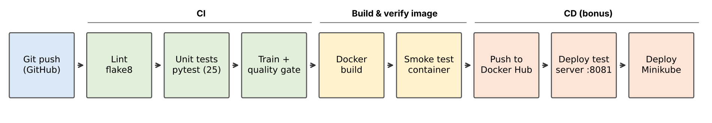

# Iris Classifier: CI/CD for a Reproducible ML Research Project

A small machine-learning research project (Iris species classification on the
real UCI dataset) with a full CI/CD pipeline built on **Git/GitHub, Docker,
Jenkins and Kubernetes (Minikube)**.

Assignment 5: *DevOps and CI/CD: Automating Processes for Research Projects*.

## Dataset

Fisher, R. A. (1936). *Iris* [Dataset]. UCI Machine Learning Repository.
https://doi.org/10.24432/C56C76 (CC BY 4.0). 150 samples, 4 features, 3
classes. Details, column descriptions and checksum: [`data/README.md`](data/README.md).

## Results (seed 42, stratified 80/20 split)

| Metric | Value |
|---|---|
| Model | StandardScaler + Logistic Regression |
| Test accuracy (30 samples) | **0.933** |
| Macro F1 | 0.933 |
| 5-fold CV accuracy (train set) | 0.958 ± 0.026 |

The pipeline stops if test accuracy drops below **0.90** (quality gate).

## Project structure

```
.
├── data/iris.csv              # real UCI Iris data (checksum-verified)
├── src/iris_classifier/
│   ├── data.py                # loading + validation
│   ├── model.py               # training, evaluation, prediction
│   ├── train.py               # CLI: python -m iris_classifier.train
│   ├── api.py                 # Flask REST API
│   └── wsgi.py                # gunicorn entry point
├── tests/                     # 25 pytest unit tests
├── Dockerfile                 # multi-stage image, model trained at build time
├── Jenkinsfile                # CI/CD pipeline
├── jenkins/                   # local Jenkins server (Docker Compose)
├── k8s/                       # Kubernetes Deployment + Service
└── scripts/make-jenkins-kubeconfig.sh
```

## Pipeline



```
Checkout → Install deps → Lint (flake8) → Unit tests (pytest + JUnit)
→ Train model (quality gate ≥ 0.90) → Build Docker image → Smoke test container
→ Push to Docker Hub → Deploy to test server (:8081) → Deploy to Minikube
```

Jenkins checks GitHub every 2 minutes (`pollSCM`) and runs the pipeline for
every new commit.

## Run locally (without Jenkins)

```bash
python3 -m venv .venv && source .venv/bin/activate
pip install -r requirements-dev.txt
pytest                                   # run unit tests
PYTHONPATH=src python -m iris_classifier.train --out models
MODEL_DIR=models PYTHONPATH=src gunicorn -b 0.0.0.0:8000 iris_classifier.wsgi:app
```

## Run with Docker

```bash
docker build -t iris-classifier .
docker run --rm -p 8000:8000 iris-classifier

curl http://localhost:8000/health
curl -X POST http://localhost:8000/predict \
  -H "Content-Type: application/json" \
  -d '{"sepal_length_cm":5.1,"sepal_width_cm":3.5,"petal_length_cm":1.4,"petal_width_cm":0.2}'
# {"probabilities":{"Iris-setosa":0.9808,...},"species":"Iris-setosa"}
```

## API

| Method | Path | Description |
|---|---|---|
| GET | `/health` | Liveness/readiness check |
| GET | `/info` | Model version, features, evaluation metrics |
| POST | `/predict` | JSON with the 4 measurements (cm) → species + probabilities |

## Jenkins setup (macOS / Docker Desktop)

1. Start Jenkins:
   ```bash
   docker compose -f jenkins/docker-compose.yml up -d --build
   docker exec jenkins cat /var/jenkins_home/secrets/initialAdminPassword
   ```
2. Open http://localhost:8080, paste the password, choose **Install suggested
   plugins**, create an admin user.
3. **Manage Jenkins → Credentials → System → Global → Add Credentials**
   * `Username with password`, ID **`dockerhub`**: Docker Hub username +
     access token (Docker Hub → Account settings → Personal access tokens).
4. **New Item → Pipeline**, name `iris-ml-cicd`:
   * Definition: **Pipeline script from SCM**, SCM: **Git**
   * Repository URL: `https://github.com/<your-username>/iris-ml-cicd.git`
   * Branch: `*/main`, Script Path: `Jenkinsfile`
5. **Build Now**. After the first build, Jenkins polls GitHub every 2 minutes.

## Kubernetes (Minikube) deployment (bonus CD)

```bash
brew install minikube kubectl
minikube start --driver=docker
bash scripts/make-jenkins-kubeconfig.sh
```

Upload `kubeconfig-minikube.yaml` to Jenkins as a **Secret file** credential
with ID **`kubeconfig-minikube`**. The next build deploys 2 replicas to Minikube.

```bash
kubectl get pods -l app=iris-classifier
minikube service iris-classifier --url     # open the API in Minikube
```

To skip the Kubernetes stage, run **Build with Parameters** and untick
`DEPLOY_K8S`.

## References

* Nüst, D. et al. (2020). Ten simple rules for writing Dockerfiles for
  reproducible data science. *PLoS Comput Biol* 16(11): e1008316.
  https://doi.org/10.1371/journal.pcbi.1008316
* Boettiger, C. (2015). An introduction to Docker for reproducible research.
  *ACM SIGOPS Operating Systems Review* 49(1), 71–79.
  https://doi.org/10.1145/2723872.2723882

## License

MIT for the code. The Iris dataset is licensed under CC BY 4.0.


